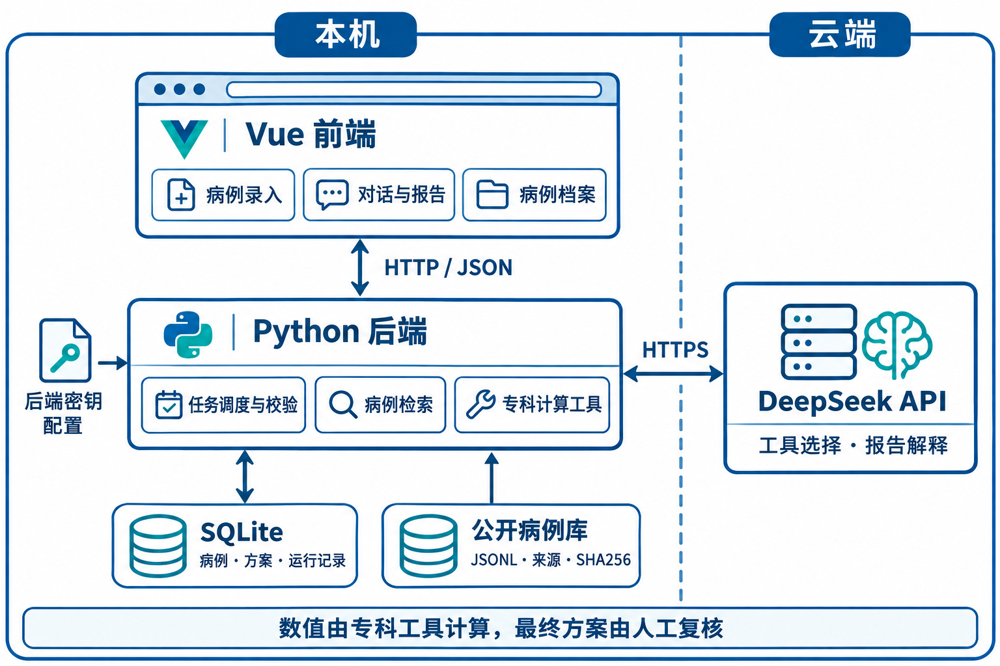
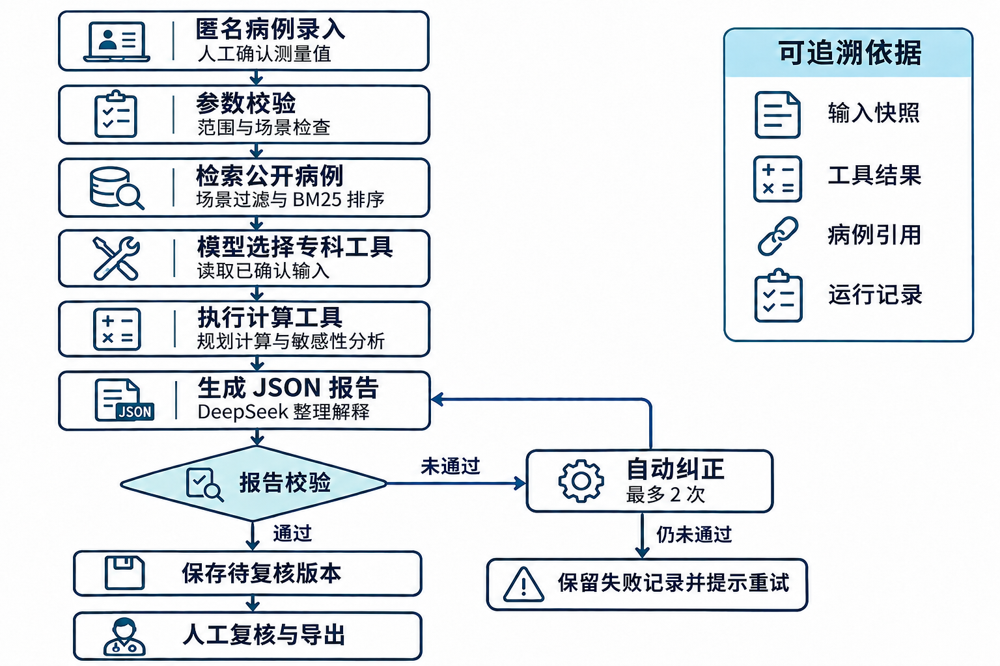
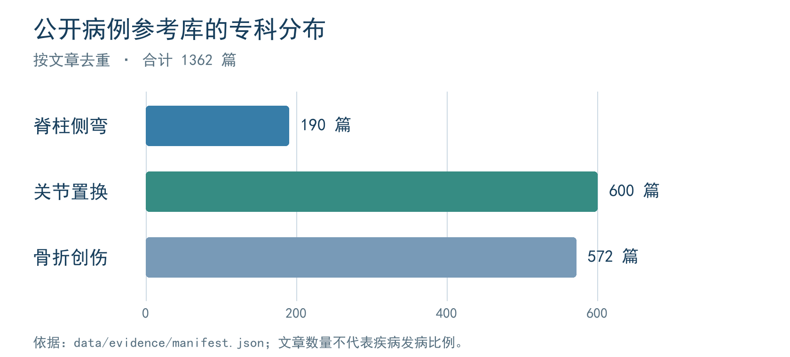
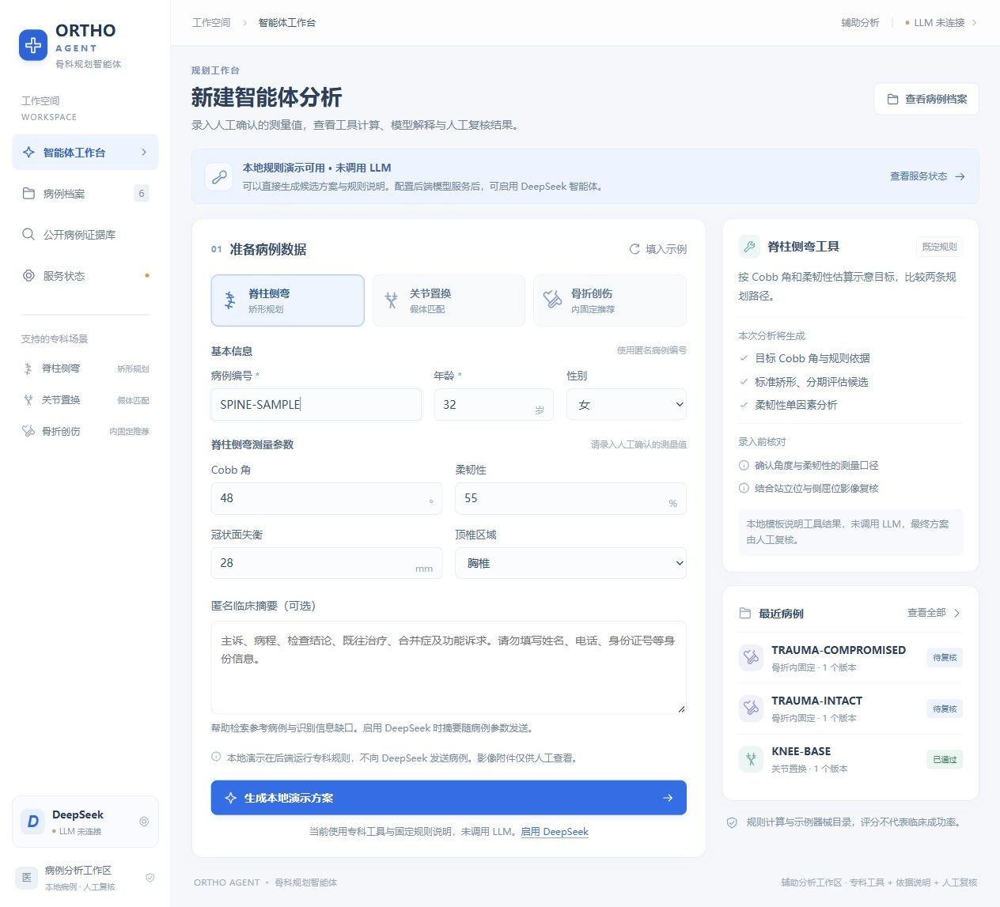
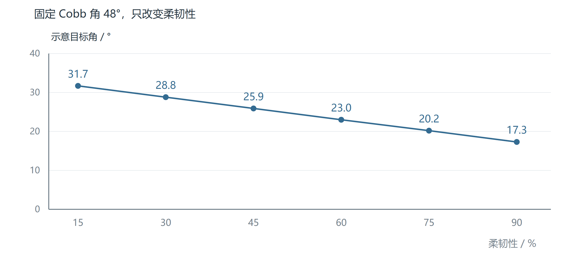
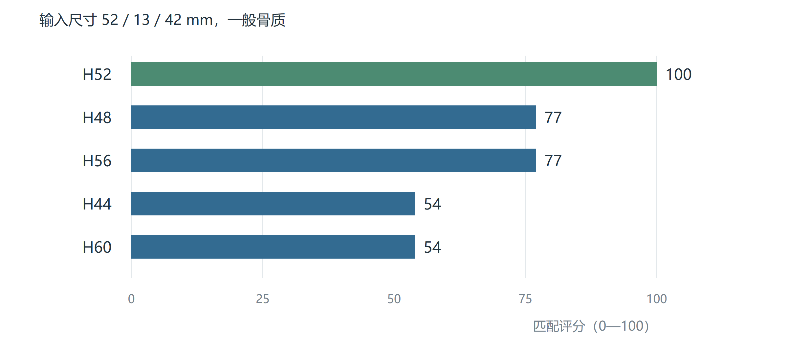
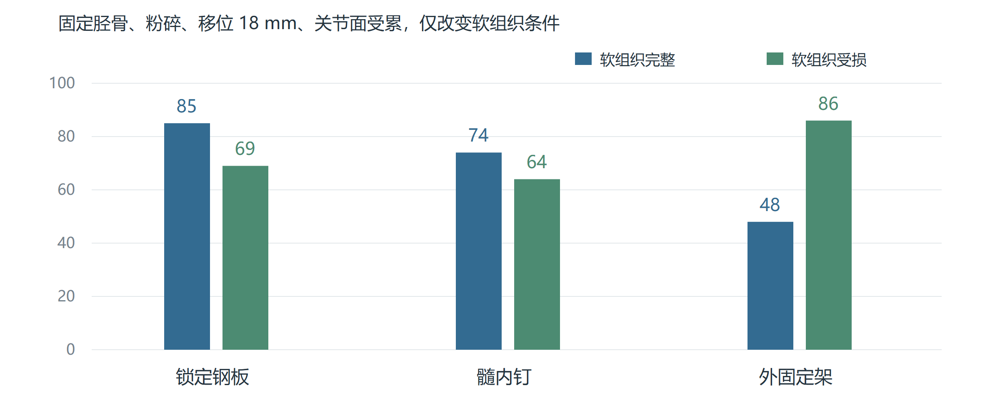

# ORTHO AGENT 骨科规划智能体

把人工确认的病例测量值、公开病例参考和可检查的专科规则连接起来，生成有来源、有计算过程、可人工复核的分析报告。覆盖脊柱侧弯、关节假体匹配与骨折内固定三个场景。

仓库：<https://github.com/Awon-111/agent> · 提交分支：`main`



## 五分钟运行

需要 Python 3.9 或更高版本。后端仅使用标准库，Vue 已随源码提供，无需 npm、数据库服务或第三方 Python 包。

```bash
git clone https://github.com/Awon-111/agent.git
cd agent
python -B app.py
```

访问 <http://127.0.0.1:8765/>。没有 Key 时可先验证本地规则、病例归档、复核及导出。需要 DeepSeek 时，把仓库根目录的 `.env.example` 复制为运行时私有配置 `.env`，填入自己的 `DEEPSEEK_API_KEY` 并重启。真实密钥不随仓库或提交包提供。

```dotenv
DEEPSEEK_API_KEY=
DEEPSEEK_MODEL=deepseek-flash
DEEPSEEK_BASE_URL=https://api.deepseek.com
```

Windows 也可运行 `start.ps1`。`auto` 模式有 Key 时调用 DeepSeek，没有 Key 时明确进入本地规则模式；云端任务失败保留失败状态，不会冒充成功结果。连接测试和真实分析会使用配置账户的 API 额度。

## 系统怎样工作

1. 输入匿名病例编号、年龄、性别、人工确认的测量值，可补充匿名摘要。
2. 按场景和部位过滤公开病例，使用 BM25 返回带原文链接的参考。
3. DeepSeek 选择工具；Python 工具只读取已保存输入，模型不能改写测量值。
4. 执行规划计算和单因素分析，再独立整理、校验 JSON 报告。
5. 保存方案版本、输入快照、引用和运行事件；由人工复核后导出。



病例分析页固定在视口内，对话与报告分别滚动，输入框保持可见。窄屏通过工作区切换查看两部分内容。

## 三个场景的可复算结果

| 场景 | 仓库示例输入 | 观察结果 |
| --- | --- | --- |
| 脊柱 | Cobb 48°、柔韧性55% | 示意矫正比例50%，示意目标24.0° |
| 髋关节 | 外径52、髓腔13、偏心距42 mm | 示例规格H52为100分，H48/H56为77分 |
| 膝关节 | 外径66、髓腔12 mm | 示例规格K66为100分；不使用偏心距 |
| 创伤 | 胫骨粉碎、移位18 mm、关节面受累 | 软组织完整时钢板85分；受损时外固定架86分 |

这些值来自 `planner.py` 的显式规则与示例目录。评分表示当前候选之间的规则比较，不是成功率；系统没有临床预测模型，也没有自动读片、分割或测角功能。

```bash
python -B scripts/reproduce_results.py
```

输入见 [examples/cases.json](examples/cases.json)，可复算结果见 [examples/results.json](examples/results.json)。运行脚本不会调用模型，也不会修改运行数据库。

## 公开病例参考

当前检索库按文章去重后共 **1362篇**：脊柱190、关节置换600、骨折创伤572。来源为 MedCaseReasoning 78篇和 PMC-Patients 1284篇。具体数量、固定下载版本和SHA256以 [manifest.json](data/evidence/manifest.json) 为准。



系统采用 RAG 使用这些文本，接入 API 不会训练或微调 DeepSeek 权重。检索相关性不能代替临床相似性评估，报告必须说明病例差异与信息缺口。原文没有记载的治疗、随访和结局不能补写。

混合语料包含 CC BY-NC-SA 4.0 的非商业、相同方式共享资料，须逐来源保留署名与许可。详见 [数据说明](docs/DATA.md) 和 [NOTICE.txt](data/evidence/NOTICE.txt)。

## 页面与结果示例

以下图片包括用户报告中的原始局部截图与当前发布版本的界面记录；截图不是临床性能验证。

| 病例录入 | 规则变化 |
| --- | --- |
|  |  |
|  |  |

## 仓库结构

```text
app.py                     HTTP接口、异步任务、SQLite与导出
agent.py                   DeepSeek工具调用、JSON整理与恢复
planner.py                 三类规则与单因素敏感性分析
settings.py                后端配置读取与校验
evidence.py                病例检索、来源策略与快照
expand_cases.py            完整文件下载、筛选与去重
import_cases.py            小样本导入工具
static/                    Vue工作台及本地资源
data/evidence/             1362篇检索文本、清单、来源与许可
examples/                  固定输入及可复算输出
scripts/                   复算、校验与提交打包
docs/                      报告、说明、截图及图表
tests.py、test_*.py         自动化测试
.github/workflows/tests.yml 持续集成
```

## 文档入口

- [使用指南](docs/USER_GUIDE.md)：启动、录入、追问、复核和导出。
- [系统架构](docs/ARCHITECTURE.md)：数据流、工具协议、任务与报告校验。
- [接口说明](docs/API.md)：方法、参数与返回行为。
- [数据与许可](docs/DATA.md)：实际覆盖、来源隔离和更新方法。
- [验证与复现](docs/TESTING.md)：81项自动化测试及固定样本复算。
- [实验报告](docs/骨科规划智能体_实验报告.docx)：以用户修改版为基础补充的图文报告。
- [报告变更说明](docs/REPORT_CHANGES.md)：保留的用户修改和本次补充。
- [提交说明](docs/SUBMISSION.md)：`main`路径约定与压缩包内容。

## 验证

```bash
python -B -m unittest discover -p "test*.py" -q
python -B scripts/check_submission.py
```

2026年11月23日，准备发布的源码实际运行 **81项测试，全部通过**。测试使用临时配置、临时数据库与本机协议服务，不消耗真实API额度。详细记录见 [docs/TESTING.md](docs/TESTING.md)。

运行时会生成数据库和附件目录；它们与真实 `.env`、缓存、日志均不纳入发布文件。第三方资源与生成插图说明见 [THIRD_PARTY_NOTICES.md](THIRD_PARTY_NOTICES.md)。
