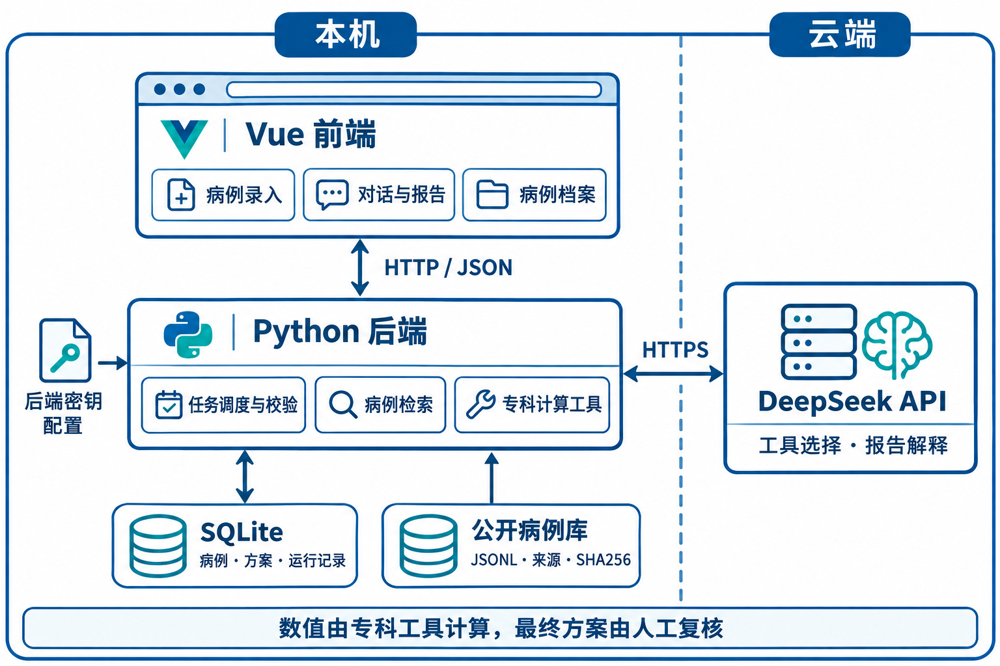
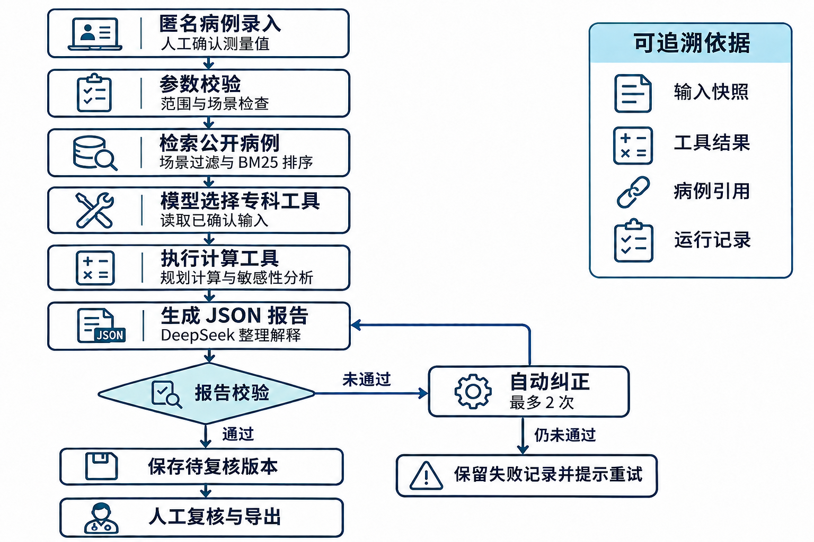

# 系统架构与数据流

本说明对应 `Awon-111/agent` 的 `main` 分支。所有路径均相对仓库根目录。

`static/app.js` 和 `static/index.html` 提供 Vue 工作台，`static/style.css` 控制视口布局与滚动区域。浏览器通过HTTP与 `app.py` 交接JSON，不直接调用DeepSeek，也不保存密钥。

| 模块 | 输入 | 输出或作用 |
| --- | --- | --- |
| `settings.py` | 私有配置、进程环境变量 | 校验后的后端配置快照 |
| `app.py` | HTTP请求、病例标识 | 病例、任务、方案版本、复核和导出 |
| `evidence.py` | 场景、部位、匿名摘要和问题 | 引用编号、文章叙述、许可和库快照 |
| `planner.py` | 已确认的结构化测量值 | 指标、候选、评分明细、敏感性分析 |
| `agent.py` | 病例、工具及检索结果 | 可校验的答复、报告和运行事件 |

## 一次分析的生命周期

创建病例时先检查类型、范围和枚举；分析请求返回202和 `run_id`，任务在后台执行。前端轮询状态，完成后取得关联方案。每个病例同时只允许一个运行任务，总时限180秒；迟到响应不能覆盖新运行或保存结果。

云端阶段先允许模型选择专科工具，后端按 `tool_call_id` 返回 `role: tool`。规划工具执行后，报告整理阶段不携带 `tools`，仅要求完整JSON，降低两种协议同时约束产生的格式问题。

## 工具边界

工具包括 `get_case_context`、`analyze_spine`、`match_implants`、`recommend_fixation` 和 `analyze_sensitivity`。工具读取病例中已确认的测量快照，模型没有自由改参或修改复核状态的权限。

最终JSON包括 `answer` 和 `report`；新规划报告包含概述、建议、依据、局限、下一步、`evidence_ids` 和 `case_comparison`。引用只能来自本轮检索结果。空输出、截断、格式或引用问题最多纠正两次，仍失败不保存部分方案。

## 数据与版本

SQLite中的 `cases`、`plans`、`agent_runs` 和 `audit` 分别保留输入、结果版本、执行记录和操作审计。方案内另存输入、工具结果、证据及语料SHA256，库更新不回写历史结果。复核绑定 `plan_id`，新版本重新待审。

云端解释与本地固定说明分别标记来源。本地规则不产生模型Token，也不改变DeepSeek的连接验证状态。上传PNG/JPEG仅存档与人工查看，不进入图像模型。

## 可编辑图源

- `docs/diagrams/architecture.mmd`
- `docs/diagrams/analysis-workflow.mmd`
- `docs/diagrams/evidence-pipeline.mmd`
- `docs/diagrams/report-recovery.mmd`

PNG用于报告排版，Mermaid源文件用于审核流程含义和后续维护。
