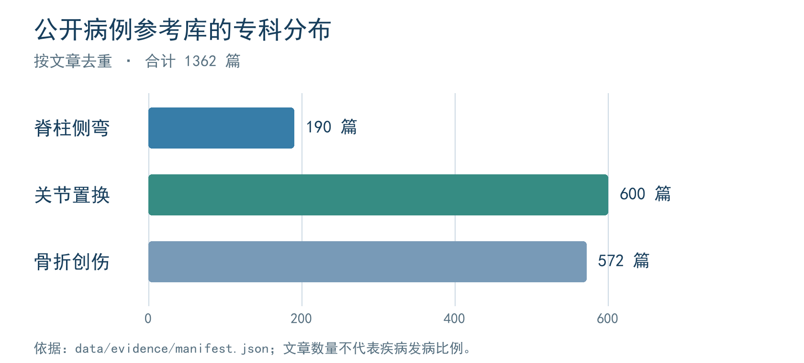

# 公开病例参考库

数据文件：`main/data/evidence/cases.jsonl`。元数据与校验值：`main/data/evidence/manifest.json`。署名和许可：`main/data/evidence/NOTICE.txt`。候选来源目录：`main/data/evidence/source_catalog.json`。



| 维度 | 实际入库数量 |
| --- | ---: |
| 脊柱侧弯 | 190 |
| 关节置换 | 600 |
| 骨折创伤 | 572 |
| 合计 | 1362 |

| 来源 | 入库篇数 | 许可 |
| --- | ---: | --- |
| [MedCaseReasoning](https://github.com/kevinwu23/Stanford-MedCaseReasoning) | 78 | CC BY 4.0 |
| [PMC-Patients](https://github.com/pmc-patients/pmc-patients) | 1284 | CC BY-NC-SA 4.0 |

上表为去重后的文章数量，不能直接当作独立患者数。标题及词项筛选并未经骨科专家标注，存在发表偏倚和专科覆盖不均衡。

## 导入与隔离

完整扫描MedCaseReasoning的14489条记录及PMC-Patients的167034条摘要。MedCaseReasoning只取train，并排除1397篇验证/测试文章在各来源中的重入；筛选跳过246行重复文章记录。原始作者发布的全科规模不等于本项目骨科数量。

```bash
python -B expand_cases.py --source all
```

下载器固定revision，分段缓存并校验完整文件大小与SHA256。只有全部下载、筛选、去重及校验成功才替换检索库；网络失败保留旧库。`import_cases.py` 用于较小子集导入，默认阻止覆盖已经扩充的多来源库。

## 检索与引用

先按场景过滤，创伤和置换进一步限定骨折部位或髋膝类型，再进行BM25排序。中文常见关键词映射到英文。每轮默认最多4篇，用E1等编号引用，同时保存原文链接、叙述、许可、查询词和库SHA256。

报告必须解释相似点、差异与未知事项。词项相关性不是医学置信度；引用编号存在不等于每一句医学陈述都受原文支持。原文未记载的治疗、随访、结局不作推断。

## 权利说明

混合库不采用统一MIT许可。MedCaseReasoning沿用作者仓库的CC BY 4.0说明，PMC-Patients遵守非商业及相同方式共享条件；原文章的具体声明仍适用。保持逐条来源、署名和许可。使用这些文本是检索增强生成，不代表对DeepSeek权重训练或完成临床验证。
