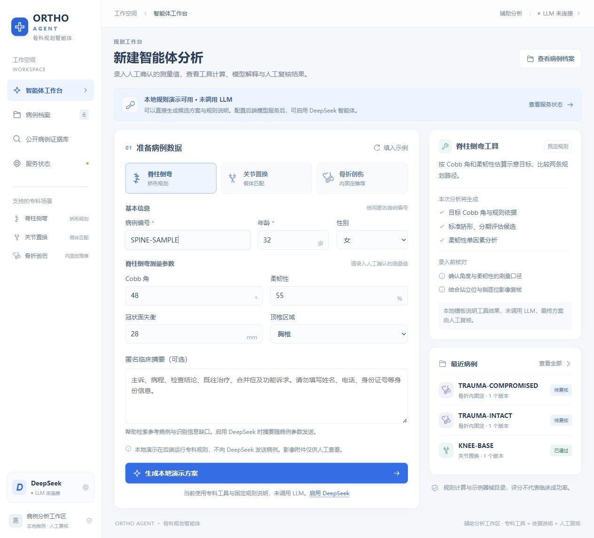

# 使用指南

以下文件均位于 `main` 分支。首次获取项目后，在仓库根目录运行 `python -B app.py`，打开 <http://127.0.0.1:8765/>。Windows可运行 `start.ps1`。

## 配置模型

把 `.env.example` 复制成运行时私有 `.env`，填入自己的Key。默认模型为 `deepseek-flash`，默认服务地址为 `https://api.deepseek.com`；是否可用以账户权限和真实连接测试为准。进程环境变量优先于文件，修改配置后重启后端。

“服务状态”页只显示脱敏配置、模型、服务地址及最近验证状态；浏览器不能修改密钥。没有Key可以先使用本地规则模式。不要把私有配置放入GitHub或提交压缩包。

## 创建病例

选择场景，填写匿名编号、年龄、性别与人工确认的参数。可填写匿名摘要帮助检索，但不要录入姓名、证件号、电话等身份信息。程序独立检查数值范围和类型；修改测量值时另建病例，保留原版本的依据。

| 场景 | 必要参数 |
| --- | --- |
| 脊柱 | Cobb角、柔韧性、冠状面失衡、顶椎区域 |
| 关节 | 髋/膝、外径、髓腔、骨质；髋另需偏心距 |
| 创伤 | 部位、形态、移位、关节面与软组织状态 |

## 查看分析

对话区显示答复及执行过程，报告区显示规则指标、候选排序、敏感性、来源和复核事项。左右独立滚动，长报告不应拉高整页；窄屏使用工作区切换。

先核对输入快照，再查看评分明细与参考病例。引用只是检索主题相关的文章，需回到原文检查年龄、病因、分型、治疗及随访差异。对话不能替代修改结构化测量参数。

## 处理失败

- 未配置模型：检查私有配置名称与进程环境变量，重启后查看状态。
- 已配置但连接失败：检查服务地址、网络、模型权限与账户额度。
- 报告校验失败：执行记录会显示恢复或失败原因，可重试；程序不会将云端失败默认为本地成功。
- 无相关病例：保留“证据不足”，不能补写不存在的出处。

## 复核和导出

选择具体方案版本，填写复核信息并通过或退回。复核结果与版本绑定；新分析产生新版本。导出后可由浏览器打印为PDF。规则分数、LLM解释及人工复核状态分别记录，复核通过本身不是医学有效性的独立验证。
